# Hi, I'm Cemre Onur Baş 👋

<picture>
  <source media="(prefers-color-scheme: dark)" srcset="./dark.svg">
  <source media="(prefers-color-scheme: light)" srcset="./light.svg">
  
</picture>

  <b>Mobile Developer · React Native & Expo · iOS · Android · Content Creator</b>

  ⚛️ React Native &nbsp;·&nbsp; 🚀 Expo &nbsp;·&nbsp; 🍎 Swift / SwiftUI &nbsp;·&nbsp; 🤖 Kotlin / Compose
  &nbsp;·&nbsp; 🎯 Flutter &nbsp;·&nbsp; 🎬 YouTube

I build **mobile apps** with React Native and Expo as well as native Swift and Kotlin, with a soft spot for **UI animation and smooth transitions**. I also publish mobile development tutorials on YouTube (in Turkish).

---

## 📱 What I Work On

- ⚛️ **Cross-platform apps**: React Native, Expo, TypeScript
- 🍎 **Native iOS**: Swift and SwiftUI
- 🤖 **Native Android**: Kotlin, MVVM, Room, Dagger Hilt and Jetpack Compose
- 🎯 **Flutter**: Dart apps and reusable widgets
- ✨ **UI animation**: Reanimated-driven interactions and shared-element transitions
- 🎬 **Developer education**: step-by-step video series on YouTube

---

## 🧩 Open Source

### ✨ [expo-hero](https://github.com/cmrnrbs/expo-hero)

Router-independent **hero (shared-element) transitions** for Expo Router and react-native-navigation. A card's photo and text fly into place on the detail screen, the way Android shared-element transitions and iOS matched geometry work.

- One codebase, two routers, two platforms
- Pure TypeScript with no native code, built on `react-native-teleport` and Reanimated
- **TypeScript · React Native · Reanimated · MIT**

---

## 🎬 Video Tutorials

Step-by-step mobile development series, in Turkish.

| Series | Stack |
| --- | --- |
| Movie Catch app | Kotlin · MVVM |
| [Kotlin Room Library](https://www.youtube.com/playlist?list=PLy-lwcPKu8i3b7r2K9WnlhYOPfozs93d1) | Kotlin · Room |
| [Flutter Movie App](https://www.youtube.com/playlist?list=PLy-lwcPKu8i1nYdfiGza13gjw7-dy9KRE) | Flutter · Bloc |
| [Ionic Movie Trailer App](https://www.youtube.com/playlist?list=PLy-lwcPKu8i0yuLDLPtXrWsFCLBfZZLLv) | Ionic |

### 📺 Latest YouTube Videos

<!-- YOUTUBE:START -->
- [Kotlin MVVM ile Movie Catch Uygulaması - Part V](https://www.youtube.com/watch?v=oUXYRefozUo)
- [Kotlin MVVM ile Movie Catch Uygulaması - Part IV - II](https://www.youtube.com/watch?v=6CSfIv9299Y)
- [Kotlin MVVM ile Movie Catch Uygulaması - Part IV - I](https://www.youtube.com/watch?v=Q_Oa6S79wPs)
- [Kotlin MVVM ile Movie Catch Uygulaması - Part III](https://www.youtube.com/watch?v=H1rfQf22WYY)
- [Kotlin MVVM ile Movie Catch Uygulaması - Part II](https://www.youtube.com/watch?v=lMJtqCmqkys)
<!-- YOUTUBE:END -->

➡️ [More videos on YouTube](https://youtube.com/channel/UCBJrbtKZi8MF2q1nHoN1AYw)

---

## 🛠️ Tech Stack

### ⚛️ Cross-platform
`React Native` `Expo` `Expo Router` `TypeScript` `Reanimated` `Flutter` `Dart`

### 🍎 iOS
`Swift` `SwiftUI`

### 🤖 Android
`Kotlin` `Jetpack Compose` `MVVM` `Room` `Dagger Hilt`

### 🌐 Web
`Next.js` `JavaScript`

---

## ✍️ Writing

### 📕 Latest Blog Posts

<!-- BLOG-POST-LIST:START -->
- [Hi, everyone this is my first post](https://dev.to/cmrnrbs/hi-everyone-this-is-my-first-post-3hgo)
<!-- BLOG-POST-LIST:END -->

➡️ [More posts on dev.to](https://dev.to/cmrnrbs)

---

## 📊 GitHub Activity

  <picture>
    <source media="(prefers-color-scheme: dark)" srcset="https://gh-readme-profile.vercel.app/api?username=cmrnrbs&amp;hide=forks%2Cprs_merged%2Cissues%2Ccontributed&amp;border_radius=12&amp;bg_color=0B1220&amp;border_color=291A53&amp;title_color=A78BFA&amp;text_color=E2E8F0&amp;icon_color=291A53&amp;stroke_color=291A53&amp;username_color=F8FAFC">
    <source media="(prefers-color-scheme: light)" srcset="https://gh-readme-profile.vercel.app/api?username=cmrnrbs&amp;hide=forks%2Cprs_merged%2Cissues%2Ccontributed&amp;border_radius=12&amp;bg_color=FFFFFF&amp;border_color=D0D7DE&amp;title_color=1D4ED8&amp;text_color=334155&amp;icon_color=2563EB&amp;stroke_color=CBD5E1&amp;username_color=0F172A">
    
  </picture>

<h2 align="center">Contribution Activity</h2>

  <picture>
    <source media="(prefers-color-scheme: dark)" srcset="https://raw.githubusercontent.com/cmrnrbs/cmrnrbs/output/github-snake-dark.svg">
    <source media="(prefers-color-scheme: light)" srcset="https://raw.githubusercontent.com/cmrnrbs/cmrnrbs/output/github-snake.svg">
    
  </picture>

---

## 📫 Connect With Me

  🎬 <a href="https://youtube.com/channel/UCBJrbtKZi8MF2q1nHoN1AYw">YouTube</a> 
  💼 <a href="https://linkedin.com/in/cemreonur">LinkedIn</a> 
  📝 <a href="https://dev.to/cmrnrbs">dev.to</a> 
  🐦 <a href="https://twitter.com/CmrNrBs">X / Twitter</a> 
  📸 <a href="https://instagram.com/cemre0nur">Instagram</a>

> Outside of code: drawing, guitar and drums 🎸
